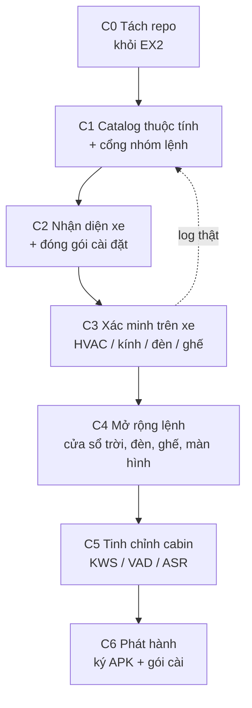
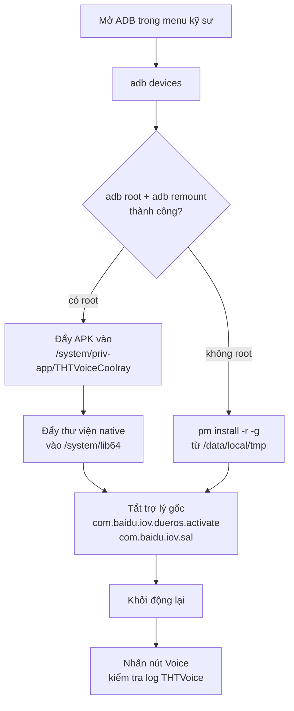

# THT Voice (Coolray) — Sơ đồ triển khai

Bản riêng cho Geely Coolray, head unit **IHU624G** (mã trong tài liệu tham chiếu) hoặc **IHU689G** (mã chủ repo dùng; script, CI và gói test phần cứng mang tên IHU689G). Không dùng chung cấu hình,
mapping hay luồng lệnh với EX2 (IHU629G). Nền voice core (ASR/KWS/TTS/UI) kế thừa
từ THT Voice; phần xe viết lại theo tài liệu tham chiếu GalaxyVoiceAssistant
(nhánh `CarModel.COOLRAY`).

Đây là tài liệu kế hoạch chính của repo này. `docs/REBUILD_PLAN.md` chỉ còn là
lịch sử nền chung.

## 1. Kiến trúc chạy trên xe

```mermaid
flowchart LR
    BTN[Nút Voice vô lăng<br/>qua AIDL bridge] --> TRIG
    KWS[Wake word offline<br/>Hey THT / Hello Geely] --> TRIG
    TRIG[Kích hoạt] --> ASR[Sherpa ASR 65M INT8<br/>offline]
    ASR --> NORM[TextNormalizer + alias lỗi ASR]
    NORM --> PARSE[DynamicCommandParser<br/>Typed VoiceCommand]
    PARSE --> CAP{CoolrayCapabilities<br/>nhóm đã bật?}
    CAP -- không --> REJ[Rejected + câu giải thích<br/>không ghi xuống xe]
    CAP -- có --> GATE{Cổng an toàn<br/>số P / tốc độ}
    GATE -- chặn --> REJ
    GATE -- qua --> EXE[Executor Coolray]
    EXE --> VHAL[(CarPropertyManager<br/>IHU624G / IHU689G VHAL)]
    VHAL --> RB[Read-back]
    RB --> TTS[Kokoro TTS offline<br/>chỉ nói "Đã..." khi read-back khớp]
    PARSE --> ANDR[Android: app / media / bản đồ]
```

Nguyên tắc giữ nguyên từ nền chung: local-first, fail-closed, không báo thành
công trước khi đọc lại trạng thái.

## 2. Lộ trình triển khai



### C0 — Tách repo (xong)
- [x] Khởi tạo từ nền THT Voice, repo `meomeo2099/THTVoice-Coolray`.
- [x] Ghi rõ trong `AGENTS.md`: không thêm lại luồng EX2 (EV, sạc, regen, cốp trước).

### C1 — Catalog thuộc tính + cổng nhóm lệnh (xong, chưa thử xe)
- [x] `car/CoolrayProperties.kt` theo tham chiếu Coolray: HVAC power area 5, A/C area 117, quạt 1..8 area 5, hướng gió bitmask area 1, kính `591405227` (dự phòng `322964416`).
- [x] `voice/CoolrayCapabilities.kt`: chỉ HVAC cơ bản, kính, truy vấn trạng thái (sau đó thêm cửa sổ trời, đèn, ghế); nhóm khác `Rejected`.
- [x] ~~Cốp sau `554768640` area 0, chỉ khi số P, có read-back~~ — bỏ theo quyết định chủ repo (01/10/2026); lệnh "mở cốp" trả lời chưa hỗ trợ.
- [x] Bảng trạng thái: `docs/COOLRAY_IHU624G_PROPERTIES.md`.
- [x] Chỉ dùng property/area từ phần Coolray của GalaxyVoiceAssistant; catalog và executor EX2 đã xoá (parser giữ nguyên, lệnh EX2 bị từ chối). Bỏ fallback kính `322964416`, fallback sấy kính sau/gương EX2; tắt lấy gió trong, sấy kính trước, HVAC Eco, đảo gió; truy vấn trạng thái chỉ còn tốc độ/số/nhiệt độ/quạt (01/10/2026).
- [x] Nhiệt độ điều hoà theo tham chiếu (ChangeAcTempHandler, khớp REF-VOICE): 15,5..28,5 °C bước 0,5; nói được "22 rưỡi", "22 phẩy 5", "22,5", "tăng nửa độ"; đọc "rưỡi" khi trả lời (01/10/2026).

### C2 — Nhận diện xe + đóng gói cài đặt
- [x] Nhận diện head unit lúc khởi động: `car/CoolrayHeadUnit.kt` đọc `ro.product.*` (cùng danh sách với tham chiếu), nhận `IHU624G` hoặc `IHU689G`. Không khớp → `VehicleCommandRouter` từ chối mọi lệnh ghi xuống xe ("Không nhận ra màn hình xe, đã chặn lệnh điều khiển xe."), vẫn cho truy vấn trạng thái chỉ đọc và lệnh Android. Xe giả lập (mock) không bị chặn. Log `THTVoiceService`: "Coolray head unit: …" (01/10/2026, REFERENCE).
- [x] Audio usage cho giọng trợ lý: tham chiếu dùng `DEFAULT_USAGE = 1` (USAGE_MEDIA) cho Coolray; THT Voice đã phát TTS bằng `USAGE_MEDIA` nên giữ nguyên, không dùng usage loa ngoài của E5/Starship (01/10/2026).
- [x] Đợt dọn EX2 số 2 (01/10/2026): script/CI/gói test phần cứng đổi sang IHU689G; bỏ probe cửa/cốp và AVAS/ADAS/đèn của EX2.
- [x] Đợt dọn EX2 số 3 (01/10/2026): xoá tài liệu/tham chiếu EX2, `Ex2EcarxFunctions`; viết lại AGENTS.md, HANDOFF_WORKFLOW.md, AGENT_PROMPT.md theo Coolray; file mẫu câu đổi thành `docs/reference/voice/VOICE_PHRASES.csv`.
- [x] Script cài đặt `scripts/install-coolray.sh` (nhận cả IHU624G và IHU689G) (root / non-root / gỡ) — xem mục 3.
- [x] Application ID `com.tht.voice.coolray2025` (quyết định chủ repo 01/10/2026): cài song song với bản EX2, license và OTA riêng; namespace/R class giữ `com.tht.voice`.

### C3 — Xác minh trên xe (đang chờ xe)
Mỗi dòng phải có log `adb logcat` trước khi đổi REFERENCE → VERIFIED.
- [ ] Đọc toàn bộ thuộc tính ở bảng "Đã bật" (chỉ đọc, chưa ghi).
- [ ] HVAC: nguồn, A/C, nhiệt độ 15,5..28,5 (bước 0,5), quạt 1..8, hướng gió 1..7, sấy kính sau.
- [ ] Sấy kính trước (`354419975`/117, dự phòng `557846585`), lấy gió trong/ngoài (`354419976`/117), làm lạnh nhanh (`354419974`/117), sưởi vô lăng (`289408269`, tắt = 0): đã bật theo REF-SYSUI/REF-WIDGET, cần đọc lại trên xe.
- [ ] Kính 4 cửa: mở/đóng/phần trăm/hé 10 %, đọc lại phần trăm.
- [ ] Đơn vị `PERF_VEHICLE_SPEED` trên xe (km/h hay m/s).

### C4 — Mở rộng lệnh (sau C3, mỗi nhóm một PR có test)
- [x] Cửa sổ trời area 65536 và rèm area 131072 (rèm tối thiểu 16): `SunroofCommandParser` ("mở/đóng/hé cửa sổ trời", "mở cửa sổ trời 50 phần trăm", "mở/đóng rèm che nắng"), `SunroofVoiceCommandExecutor` theo tham chiếu (bước 4, kính 12..88, rèm 16..88, mở kính thì mở rèm theo), đọc lại trước khi báo thành công; xác nhận khi xe đang chạy giống kính cửa (01/10/2026, REFERENCE). Gói giọng đọc đã tải trước đó chưa có các từ mới ("trời", "rèm", "nắng") cho tới khi gói được build lại.
- [x] Đèn trong xe `356519684`, đèn ngoài `557871126`, đèn sương mù `289410578`: `CoolrayLightCommandParser` ("bật/tắt đèn trong xe | nội thất | trần | cabin", "bật đèn cốt | chiếu gần | pha", "bật đèn định vị", "tắt đèn ngoài xe", "bật/tắt đèn sương mù | gầm"), `CoolrayLightingVoiceCommandExecutor` ghi đúng giá trị tham chiếu và đọc lại; đèn ngoài/sương mù cần xác nhận khi xe chạy. "Bật đèn" chung chung và đèn viền vẫn bị từ chối (01/10/2026, REFERENCE).
- [x] Sưởi / thông gió ghế `356517131` / `356517139` area 1 lái, 4 phụ: `SeatClimateCommandParser` ("bật/tắt sưởi ghế", "thông gió / làm mát ghế phụ", "mức 1..3", "cao nhất", "tăng/giảm", "hai ghế trước"; không nói ghế = ghế lái, không nói mức = 2 như tham chiếu), `SeatClimateVoiceCommandExecutor` đọc lại từng ghế; tăng/giảm phải đọc được mức hiện tại (01/10/2026, REFERENCE).
- [x] ~~Độ sáng màn hình `687997952` area 2, tự động `555775150`~~ — bỏ theo quyết định chủ repo (01/10/2026). Lệnh độ sáng giữ đường Android cũ; mã vẫn ghi trong catalog, không gắn lệnh giọng nói.
- [x] ~~Nắp bình xăng `287310600`~~ — bỏ theo quyết định chủ repo (01/10/2026); mã chỉ còn trong catalog.
- [x] Nguồn thứ hai **REF-WIDGET** (chủ repo đồng ý 09/10/2026, REFERENCE): sấy kính trước (`557846585` → đọc `268698880`/117), sưởi vô lăng `289408269` (`SteeringWheelHeatCommandParser` / `...Executor`), đường dự phòng một lần cho sấy kính sau (`591400996`/2) và sưởi ghế (`624955432`), truy vấn xăng, quãng đường còn lại, ODO, chuyến đi, tiêu hao, nước làm mát, ắc quy, áp suất lốp, bảo dưỡng. Gói giọng đọc cần build lại để có từ mới (tự làm khi chạy Release candidate).
- [x] Nguồn thứ ba **REF-SYSUI** (16/10/2026, REFERENCE): sấy kính trước dùng `354419975`/117 trước, lệnh MCU REF-WIDGET làm dự phòng; bật lấy gió trong/ngoài `354419976`/117; lệnh mới làm lạnh nhanh `354419974`/117 (`MaxAcCommandParser`); sưởi vô lăng tắt bằng 0 (REF-SYSUI 0..3), xe từ chối thì thử -1 một lần.
- [ ] Nút vô lăng (`557872226/227/232`) cho media: chỉ khi xác nhận head unit Coolray có cùng mã.

### C5 — Tinh chỉnh cabin
- [ ] Đo độ trễ / CPU của ASR 65M INT8 trên head unit Coolray.
- [ ] Tinh chỉnh ngưỡng KWS, VAD theo tiếng ồn cabin Coolray (máy xăng, khác EV).

### C6 — Phát hành
- [x] Cấu hình máy chủ bản quyền riêng cho Coolray trong `worker/` (tên worker, D1, trang quản lý, mã khóa `c1`, repo cập nhật THTVoice-Coolray) (01/10/2026).
- [x] Máy chủ Coolray đã deploy: `https://tht-voice-coolray-license.mavoice.workers.dev`, khóa `c1`; app trỏ sang máy chủ này, build báo lỗi nếu `publicKeys` trống (02/10/2026).
- [x] Ký APK release + `RELEASE_CERT_SHA256` (chặn bản cài bị ký lại): keystore và secret đã cấu hình; bản ký đầu tiên `release-1.0.1-2` (02/10/2026), mới nhất `release-1.0.4-5` (09/10/2026). **16/10/2026: chuyển sang khóa ký mới** (secret `THT_SIGN_*`); bản đầu tiên ký khóa mới cần gỡ app cũ rồi cài lại một lần, Worker để `RELEASE_CERT_SHA256` gồm cả SHA khóa cũ và mới trong thời gian chuyển.
- [ ] Gói zip gồm APK + thư viện native + script cài (hiện phát hành APK; script lấy từ repo).
- [x] Hướng dẫn cài cho người dùng cuối bằng tiếng Việt: `docs/HUONG_DAN_CAI_DAT_COOLRAY.md` (01/10/2026).
- [x] Script cài root tự tách thư viện native từ APK vào `/system/priv-app/THTVoiceCoolray/lib/arm64` và chép whitelist quyền `scripts/privapp-permissions-com.tht.voice.coolray2025.xml` (tránh treo khởi động khi `ro.control_privapp_permissions=enforce`); CI kiểm tra whitelist khớp manifest (01/10/2026).

## 3. Sơ đồ cài đặt lên xe



Lưu ý từ tham chiếu: Coolray thường **cần patch framework** mới cài được bản
root. Nếu `adb remount` thất bại thì dùng đường non-root. Cài đặt can thiệp vào
hệ thống, chỉ làm khi hiểu rủi ro và có cách khôi phục.

Lệnh tương ứng: `scripts/install-coolray.sh root|nonroot|uninstall <apk>`.

## 4. Quy tắc làm việc
- Mỗi bước xong: cập nhật checkbox ở đây, commit và push.
- Không bật nhóm lệnh nào trong `CoolrayCapabilities` khi chưa có mapping Coolray và test.
- Số hiệu chỉ có từ EX2 không được dùng cho Coolray.
