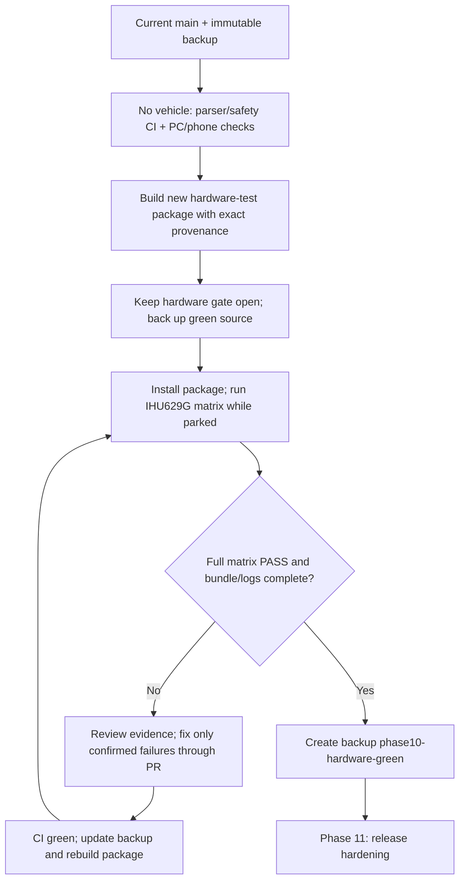
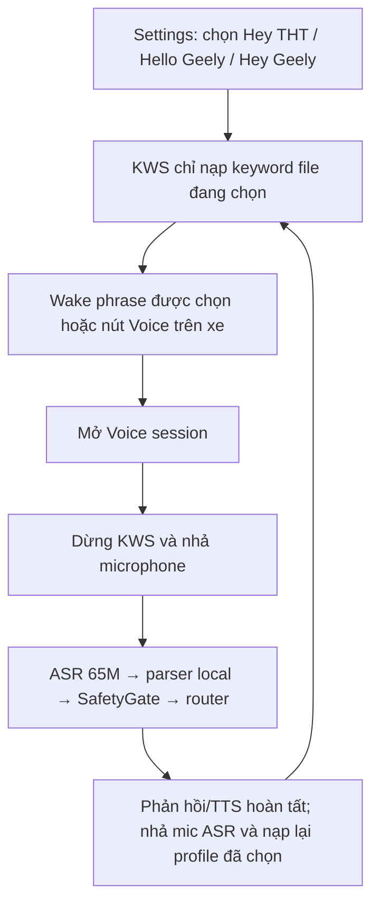

# THT Voice — Rebuild plan (lịch sử nền chung)

> **Bản Coolray:** kế hoạch và sơ đồ triển khai chính là `docs/COOLRAY_DEPLOYMENT_PLAN.md`. Các phase dưới đây là lịch sử của nền chung/EX2, không phải việc cần làm cho Coolray. Nhiều file được nhắc tới bên dưới (catalog, executor, tài liệu EX2) đã bị xoá khỏi repo này ngày 01/10/2026; xem repo `meomeo2099/THTVoice` nếu cần.

THT Voice v1.0 theo kiến trúc typed-command, local-first, fail-safe và chỉ báo thành công sau khi xác minh trạng thái.

> Hướng dẫn làm việc / handoff cho người tiếp theo: `docs/HANDOFF_WORKFLOW.md`.

> UI/public branding authoritative: **THT Voice only**. Xem `docs/UI_BASELINE.md` và `docs/ui/NO_BRAND_FINAL.md`.

## Phase 1 — Voice core
- [x] Text normalizer + Vietnamese number parser.
- [x] Typed command model + deterministic local parser.
- [x] ACK → EXECUTE → VERIFY → RESULT coordinator.
- [x] FULL / SHORT / SILENT response policy.
- [x] Vehicle + Android command router.
- [x] Câu ngoài phạm vi command phản hồi local, không tự gọi Internet.
- [x] Test độ phủ 3.230 mẫu câu (`VoicePhraseCoverageTest`, chuỗi `VoiceParseChain` dùng chung với service): 1.410 → 1.981/2.841 câu nhóm đã hỗ trợ; sửa "kính trước trái và phải" chỉ mở một kính và "bật điều hòa lên" thành tăng nhiệt độ.

## Phase 2 — HVAC
- [x] Temperature 16–32°C, relative up/down, HI/LO.
- [x] Regression: 20/22/hai không được nhầm sang HI.
- [x] Regression bổ sung: `hai hai` trong ngữ cảnh HVAC → 22°C; `hi mươi` / `hi mươi hi` được xử lý như lỗi ASR số 2, không kích hoạt HI.
- [x] HVAC power, A/C, fan 0–8, recirculation.
- [x] "Quạt nhỏ/thấp/yếu nhất" = mức 1 (không tắt quạt); "tắt quạt" vẫn = 0 (quyết định chủ repo 29/09/2026).
- [x] Front/rear defrost + fan direction.
- [x] Sấy gương = alias sấy kính sau (sấy/sưởi gương, gương bị mờ, kính hậu/chiếu hậu) + fallback `591400996` → `320865556` → `557884277`, chỉ ghi đường đọc được và phải read-back (REFERENCE/UNVERIFIED; HVAC-06/07 `NOT_TESTED`).
- [x] Điều hòa tiết kiệm (HVAC Eco) bật/tắt: `268960000` area `117`, bỏ qua write khi đã đúng trạng thái, read-back; tách khỏi drive mode Eco (REFERENCE/UNVERIFIED; HVAC-08 `NOT_TESTED`).
- [x] Tự động đảo gió bật/tắt: `557846566` area `0`, bắt buộc đọc trước (không đọc được thì không ghi), bỏ qua write khi đã đúng, read-back; tách khỏi tuần hoàn gió (REFERENCE/UNVERIFIED; HVAC-09 `NOT_TESTED`).
- [x] Read-back trước khi nói `Đã ...`.
- [ ] Xác nhận toàn bộ HVAC trên xe thật bằng log.

## Phase 3 — Windows
- [x] 4 cửa + ALL.
- [x] "Kính bên trái/phải" không nói trước/sau = kính trước (quyết định chủ repo 29/09/2026). Không nhận "cửa" thay cho kính; không thêm alias "chốt cửa"/"mở cửa".
- [x] OPEN / CLOSE / SET_PERCENT.
- [x] STOP best-effort, không giả `Confirmed`.
- [x] Dynamic range + read-back phần trăm.
- [x] "Hé kính" = mở 10 % (trước đây mở hết); nhận lỗi ASR "kênh"/"kín" = kính; "hé kính" không chỉ rõ kính = hé cả 4 kính 10 % (29/09/2026).
- [x] Primary property `322964416`, fallback `591405227`; areas `16/64/256/1024`.
- [ ] Xác nhận executor trên xe thật.

## Phase 4 — Vehicle commands
- [x] Drive mode Eco / Comfort / Sport + read-back.
- [x] Regeneration Low / Medium / High + read-back.
- [x] Cảm giác bàn đạp phanh Comfort/Sport và Comfortable Stop: typed parser, PARKED_ONLY, kiểm tra lại telemetry trước write và read-back (PR #90; chỉ xác minh bằng CI, chưa xác minh trên xe THTVoice).
- [x] Giới hạn dòng sạc 5–32 A: chỉ khi đỗ ở P, cáp đã cắm, area đọc được hợp lệ và read-back cùng area (PR #92; CI/JVM, chưa xác minh trên xe THTVoice).
- [x] Dừng/khởi động sạc có state machine fail-closed: STOP `605028611 → 605028609`, START_NOW `605028609 → 605028611`, bắt buộc P + cáp + pre-state + recheck + exact read-back; `605028610` chưa expose vì semantics chưa đủ chắc (PR #111–#116; CI/JVM, chưa xác minh trên IHU629G).
- [x] Tự giảm gạt mưa khi đỗ: typed parser, PARKED_ONLY và read-back property 557883700 area 0 (PR #93; JVM/CI, chưa xác minh trên xe THTVoice).
- [x] Chế độ đỗ theo thời lượng hữu hạn: tắt/30 phút/1–5 giờ, typed PARKED_ONLY + read-back (PR #94; JVM/CI, chưa xác minh trên xe THTVoice).
- [ ] Chế độ đỗ liên tục: giữ catalog-only cho tới khi xác minh semantics và ảnh hưởng tiêu thụ điện trên xe.
- [x] Read-only status query cho property/mapping đã xác nhận.
- [x] Truy vấn nhiệt độ trong xe: `358614274` area `1`, loại giá trị sentinel (`0`, ngoài `-40..90` °C, NaN) (REFERENCE/UNVERIFIED; STATUS-CABIN-01 `NOT_TESTED`).
- [x] Truy vấn cài đặt tự đóng kính khi khóa xe: `537396224` area `0`, `1` bật / `0` tắt, giá trị khác bị từ chối; chỉ đọc (STATUS-AUTOCLOSE-01 `NOT_TESTED`).
- [x] Truy vấn trạng thái ga tự động qua float property `557884450` area `0`, chỉ ánh xạ `0/1/7` (tắt/chờ/hoạt động); giá trị lạ hoặc không đọc được bị từ chối. Chỉ kiểm thử JVM/CI, chưa xác minh trên IHU629G.
- [x] Dò read-only khả năng mở scene nghỉ/cắm trại qua package và activity Android từ PR #78; chỉ báo trạng thái component, không kích hoạt scene, không truy vấn provider khi thiếu schema (JVM/CI; chưa xác minh IHU629G).
- [x] Mở màn hình chế độ nghỉ/cắm trại bằng giọng nói qua activity OEM, PARKED_ONLY, chỉ báo "đã mở màn hình" (SCENE-06 `NOT_TESTED`).
- [ ] Bật/tắt scene nghỉ/cắm trại thật (ghi trạng thái): chờ kiểm tra quyền, API/state contract và xác minh trạng thái thực trên IHU629G.
- [x] Door/lock/trunk contract: giữ behavior token trung tính, classifier fail-closed, JVM regression và probe ADB chỉ đọc; `DOOR_LOCK_STATE` chỉ làm read-back (lát cắt contract 28/09/2026).
- [ ] Door/lock/trunk actuator: chờ exact backend/API, permission/signature và independent trunk read-back; parser vẫn chưa nối.
- [ ] AVAS voice command: `DEFERRED` (29/09/2026, quyết định chủ repo). Đã có probe read-only + executor cô lập; chưa nối parser/router.
- [ ] Battery/range/ODO/outside temperature chỉ gắn hardware-confirmed sau log thật.

## Phase 5 — Android / Media / Navigation
- [x] OpenApp / SearchMedia / MediaControl / Navigate typed commands.
- [x] Explicit package launch, không fallback YouTube sang browser.
- [x] Media priority: YouTube → Vanced → ReVanced → Morphe → SmartTube.
- [x] Navigation: Google Maps / VietMap Live / Waze.
- [x] Play/Pause/Toggle + volume read-back.
- [x] Tắt/bật tiếng luồng media có read-back `isStreamMute`; giọng trợ lý vẫn nói khi đang tắt tiếng: lúc trợ lý nói, app xin audio focus tạm thời (trình phát nhạc tạm dừng), bỏ tắt tiếng đúng thời gian câu nói rồi tắt lại; nếu không được focus (ví dụ đang gọi điện) thì giữ im để không lộ nhạc (quyết định chủ repo, MED-04 `NOT_TESTED`).
- [x] Next/Previous chỉ `Confirmed` khi MediaSession chứng minh track đổi.
- [x] Apps screen dùng PackageManager, favorite, default app, Voice test.
- [x] Mở bằng giọng nói **mọi app đã cài** hiện trên màn hình Ứng dụng: "mở/bật + tên app" so với nhãn PackageManager, kèm bảng chính tả ASR (gia lô → Zalo, ép phê tê → FPT Play…); câu phản hồi không đọc tên app động vì Kokoro chỉ đọc từ trong lexicon (APP-01 `NOT_TESTED`).
- [x] Truy vấn read-only trạng thái bật/tắt Wi-Fi qua Android `WifiManager`, xác minh giá trị đọc trước khi trả lời (JVM/CI; chưa có log IHU629G cho lệnh này).
- [x] Truy vấn IP nội bộ IPv4 của mạng Wi-Fi mặc định qua ConnectivityManager/LinkProperties; chỉ trả lời khi transport là Wi-Fi và đọc được IPv4 (JVM/CI, chưa có log IHU629G).
- [x] Truy vấn SSID của mạng Wi-Fi mặc định khi đã cấp vị trí chính xác và bật dịch vụ vị trí; giá trị bị Android che không được đọc thành công (JVM/CI; chưa xác minh IHU629G).
- [x] Mở Android Wi-Fi Settings bằng public intent, tách khỏi radio toggle và không nói đã bật/tắt (PR #108).
- [ ] Bật/tắt Wi-Fi trực tiếp: Android target API 32 không cho ứng dụng thường đổi trạng thái; chờ API OEM/quyền hệ thống được xác minh.
- [x] Truy vấn read-only thiết lập sáng tự động hoặc mức sáng hệ thống Android; không đánh đồng với độ sáng vật lý hay theme VHAL (JVM/CI; chưa có log IHU629G).
- [x] Đặt mức sáng hệ thống thủ công 1–100% khi xe xác nhận đỗ, Android cấp `WRITE_SETTINGS` và read-back khớp cả mode/level (JVM/CI, chưa xác minh IHU629G).
- [x] Chuyển AUTO/MANUAL cho Android brightness mode có PARKED_ONLY, `WRITE_SETTINGS`, recheck trước write và read-back sau write; thiếu quyền hoặc mode đọc lại không khớp thì fail-closed (PR #109–#110; chưa xác minh IHU629G/OEM behavior).
- [x] Dò read-only feature flags PiP/freeform Android; split-screen không có contract công khai nên báo chưa xác minh, không tự mở app/cửa sổ (JVM/CI; chưa kiểm tra IHU629G).
- [x] Dò PiP theo app mục tiêu và wire vào runtime ở mức precondition `APP_VISIBLE_UNVERIFIED`; không launch app, không enter PiP, không đổi task/window state (PR #102–#107).
- [ ] Điều khiển split/freeform/PIP: cần API/quyền OEM, khả năng ứng dụng mục tiêu và xác minh task/window thực tế.
- [x] Lệnh Android cục bộ: màn hình đen bật/tắt (bật là PARKED_ONLY, chạm để mở lại), "đóng tất cả ứng dụng" = về màn hình chính (không giả là đã đóng app), hỏi giờ/ngày/trạng thái trợ lý từ đồng hồ máy (UI-03..05 `NOT_TESTED`).
- [ ] Test MediaSession/app/nav trên head unit thật.

## Phase 6 — Offline Voice
- [x] Sherpa-ONNX Vietnamese ASR 65M facade.
- [x] Offline wake phrase profiles: **Hey THT** (mặc định), **Hello Geely** và **Hey Geely**; người dùng chọn trong Settings.
- [x] Giữ branding ứng dụng là THT Voice; Geely phrases chỉ là tùy chọn wake phrase, không phải tên/logo UI.
- [x] KWS offline + mic state machine pause/resume quanh ASR/TTS.
- [x] VAD/endpoint runtime baseline: RMS `0.012`, min speech `180 ms`, trailing `700 ms`, max listen `12 s`.
- [x] Groq STT/LLM không còn trên đường command chính.
- [x] ASR diagnostics: latency / CPU / PSS / RTF; không lưu raw audio/transcript.
- [x] Hardware-validation collector cho IHU629G.
- [x] Hardware-test workflow stage Sherpa runtime + ASR 65M INT8 + đủ ba KWS profiles ngoài Git history.
- [x] Mic ownership/handoff diagnostics cho KWS → ASR → processing → KWS.
- [x] Stage production TTS voice assets cho Ngọc Huyền / Diễm Trinh vào hardware-test package (PR #185).
- [ ] Tune KWS/VAD trong cabin thật.
- [ ] Benchmark 65M INT8 trên IHU629G; chỉ cân nhắc 30M nếu số đo thật chứng minh cần thiết.

## Phase 7 — Buildable Android baseline
- [x] AndroidManifest + app theme/resources.
- [x] `VoiceAssistantService` foreground.
- [x] Sherpa runtime/model staging ngoài Git history.
- [x] Offline TTS engine + sound feedback.
- [x] GitHub Actions PR gate: PowerShell parse + Phase 10 matrix validator + model/TTS staging tests + hardware package provenance self-test + unit test + `assembleDebug`.
- [x] PR CI không phụ thuộc artifact quota; artifact debug chỉ best-effort ngoài PR.
- [x] Manual `IHU629G hardware test APK` workflow + APK SHA256 + BUILD_INFO + ASSET_SHA256 provenance manifest.
- [x] Hardware package metadata ghi hash APK / Sherpa runtime / test matrix / asset manifest để truy ngược chính xác phiên test.
- [x] Safe updater: download → SHA/package/version/signature validation → parked install gate.
- [x] Không OTA khi xe chạy: chặn cả kiểm tra máy chủ và tải khi xe không ở P/đứng yên; đang tải mà xe chạy thì dừng + xóa file tạm (OTA-01 `NOT_TESTED`, 29/09/2026).
- [x] Overlay Voice realtime + drag + auto-hide.
- [ ] Release signing/customer release pipeline sau hardware validation.

## Phase 8 — UI / Security baseline locked
- [x] 6 menu: Trang chủ / Trợ lý / Ứng dụng / Cài đặt / Ủng hộ / Giới thiệu.
- [x] Dark/cyan landscape baseline 1920×1080.
- [x] Popup final: `docs/ui/POPUP_FINAL_APPROVED.jpg` + `POPUP_FINAL.md`.
- [x] Security final: `docs/ui/SECURITY_ACTIVATION_UI_APPROVED.jpg` + `SECURITY_ACTIVATION_UI.md`.
- [x] No-brand policy: `docs/ui/NO_BRAND_FINAL.md`.
- [x] Ảnh xe/UI không dùng tên/logo/badge hãng làm branding.
- [x] Wake phrase người dùng chọn là Hey THT / Hello Geely / Hey Geely; nút phần cứng gọi trung tính là **Nút Voice trên xe**.

## Phase 9 — Android UI implementation
- [x] Navigation shell 6 menu.
- [x] Trang chủ runtime.
- [x] Trợ lý runtime: listening / processing / result / error.
- [x] Ứng dụng runtime bằng PackageManager.
- [x] Cài đặt landscape + save/default restore.
- [x] Popup ngang 3 cụm + settings + persisted drag position.
- [x] Bố cục tự co giãn theo thiết bị (1024×600 → 2000×1200, ngang/dọc); 1920×1080 giữ nguyên bản đã duyệt (29/09/2026). Cần xem trực quan trên thiết bị thật.
- [x] Bổ sung khớp UI_BASELINE: xem trước popup trong Cài đặt, lệnh nhanh "Xe" ở Trợ lý, nhật ký phiên bản + hướng dẫn cập nhật theo tính năng hiện tại (29/09/2026).
- [x] Support screen 2 cột + QR local + copy STK.
- [x] About screen no-brand + runtime app/system info.
- [x] Màn chính mở sau khi Voice core đã chạy (ví dụ khởi động cùng xe) hiển thị đúng trạng thái sẵn sàng (trước đây kẹt "Chưa sẵn sàng" vì chỉ nghe broadcast mới); đổi nhãn "ASR 65M"/"TTS" thành "Nhận giọng nói"/"Giọng trợ lý" (29/09/2026).
- [x] Giọng trợ lý im lặng dù lệnh chạy: bản copy Kokoro trong bộ nhớ app từ bản test cũ hoặc copy dở được dùng lại mãi. Nay có stamp theo lần cài APK + copy qua thư mục tạm; Home hiện lý do khi giọng đọc chưa sẵn sàng hoặc câu gần nhất không đọc được (29/09/2026, TTS-07 `NOT_TESTED`).
- [x] Sửa theo phản hồi dùng thật (29/09/2026): lỗi ASR "tanh/bạc/tác/tan", "sai can/cừ/cứ" → sấy kính, "bạc nè"/"đèn nội thất" → đèn viền, "cánh" → kính, "lấy"/"ghé" → lái/ghế (chỉ trong ngữ cảnh kính/ghế, không đụng "lấy gió"), "he cam/cưng" → hé kính, YouTube/VietMap nghe sai, "mở map/mát/máy" → bản đồ (quyết định chủ repo: "mở mát" là bản đồ). Giọng trợ lý bỏ qua từ không có trong lexicon thay vì im hẳn; TTS lỗi thì phát tiếng bíp. Tiếng bíp khi tắt phản hồi giọng nói tạo bằng AudioTrack (cùng đường âm thanh với giọng trợ lý) thay ToneGenerator. Độ phủ 2.678.
- [x] "Mở YouTube" không có app gốc → tự mở Vanced → ReVanced → Morphe → SmartTube (theo thứ tự chủ repo). "Mở bản đồ"/"mở map" mở ứng dụng bản đồ mặc định đã chọn (trước đây luôn Google Maps); "mở Google Maps" vẫn mở đúng Google Maps (29/09/2026).
- [x] Giao diện mới theo mẫu chủ repo (29/09/2026): thanh trên (logo, trạng thái, bản quyền, giờ), thanh điều hướng có biểu tượng, banner ảnh đêm cho Trang chủ/Trợ lý/Cài đặt/Giới thiệu, thẻ gradient, chip trạng thái, nút chọn dạng viên. Ứng dụng: nút "Mặc định" sáng lên ở app đang là mặc định, "Mặc định hiện tại" + "Thay đổi". Ủng hộ: QR VietQR tạo lúc chạy (file PNG cũ bị hỏng nên không hiện). Giới thiệu: thẻ tính năng bấm được, hộp thoại cùng phong cách app. Chưa có thời tiết/4G trên thanh trên (thời tiết online ngoài phạm vi). Cần xem trực quan trên xe (UI-07 `NOT_TESTED`).
- [x] Giọng đọc Kokoro (~330 MB) tách khỏi APK thành gói tải riêng: Cài đặt → Gói giọng đọc → Tải về (thanh %) / Cài từ tệp / Xóa; APK ghim SHA-256 + kích thước gói; chỉ cài khi khớp. Worker cần thêm `/api/model` (xem `docs/OFFLINE_MODEL_PACKAGING.md`). Trigger `tts_delivery=bundled` để build APK đủ giọng (29/09/2026, TTS-08 `NOT_TESTED`).
- [x] Theo phản hồi 29/09/2026 (tối): popup Voice làm lại theo ảnh mẫu (mic phát sáng, chip trạng thái, sóng âm + câu đang nói, câu đã nhận trong khung, biểu tượng xử lý/kết quả, nút thu nhỏ/đóng); "mở YouTube" ưu tiên app YouTube mặc định (Vanced/ReVanced/Morphe/SmartTube) rồi mới tới YouTube gốc; thẻ app YouTube bản vá có nhãn tên (không vẽ lại logo của app khác); giọng hệ thống Android tiếng Việt làm dự phòng khi Kokoro chưa đọc được + nút "Thử giọng" báo rõ lý do; 3 âm báo riêng: bắt đầu nghe (lên), kết thúc nghe (xuống), lỗi (3 tiếng trầm). UI-08, TTS-09, AUD-01 `NOT_TESTED`.
- [x] Sửa lỗi gốc giọng Kokoro im lặng (29/09/2026): phát bằng AudioTrack MODE_STATIC nhưng kiểm tra `STATE_INITIALIZED` trước khi ghi dữ liệu, trong khi track static ở `STATE_NO_STATIC_DATA` tới lúc ghi → mọi câu bị bỏ. Nay phát kiểu stream; lỗi phát ghi rõ lý do cho nút "Thử giọng".
- [x] Icon mới (chủ repo chọn mẫu H màu R2, 30/09/2026): icon thích ứng (nền dải RGB, chữ T lồng H trắng với mic nhỏ và sóng âm) + icon thông báo đơn sắc (sóng âm, mic ở giữa). Thêm lỗi nghe: "mở mắt" → bản đồ, "gu gồ mát/gu gồ đáp/gu bap" → Google Maps, "you tụi bay" → YouTube.
- [x] Security / Activation full-screen gate.
- [x] `ActivationActivity` là launcher; `MainActivity` chỉ mở sau license hợp lệ.
- [x] Chưa license/expired/blocked/binding mismatch không khởi động Voice core.
- [x] Chặn bypass qua manual mic, Apps và các Voice entry points.
- [x] Activation state model + regression tests.
- [x] Fail-safe `VinProvider` qua Android Automotive `INFO_VIN`; lỗi/quyền/value lạ → `Unavailable`.
- [x] VIN chỉ hiển thị khi validate đủ 17 ký tự.
- [x] Assistant dùng telemetry backend riêng cho trạng thái VHAL, không tự đoán `CONNECTED`.
- [x] Bổ sung no-car regression cho activation payload thiếu, binding mismatch precedence, expiry/clock rollback boundary và non-expiring record (PR #114); chưa thay test Activity thực tế.
- [x] Đồng bộ bảo mật với app (29/09/2026): màn chính hết license (hết hạn / bị khóa / sai thiết bị / lùi giờ) → dừng Voice core và quay về màn kích hoạt toàn màn hình (bỏ hộp thoại kích hoạt cũ có nút "Đóng"); Voice core kiểm tra lại license ở mỗi lần kích hoạt giọng nói; tự kiểm tra máy chủ (gia hạn / khóa từ xa) tối đa 12 giờ/lần, lỗi mạng không khóa license hợp lệ; bấm trạng thái license ở đầu màn chính để xem mã thiết bị và "Kiểm tra lại"; màn kích hoạt theo bố cục tự co giãn (1920×1080 giữ nguyên bản duyệt). SEC-05..07 `NOT_TESTED`.
- [x] VIN: thêm nguồn dự phòng system property nền tảng khi `INFO_VIN` không có (`REFERENCE`/`UNVERIFIED`); màn kích hoạt ghi nguồn. Mã VIP (máy chủ trả `license_type: "vip"`) không cần VIN; license thường lưu hash VIN để dùng khi bật VIN-required. Worker cần bổ sung `license_type` (29/09/2026, SEC-08..09 `NOT_TESTED`).
- [ ] VIN-required license binding **chưa bật** cho đến khi hardware validation xác nhận VIN đọc ổn định.

### Phase 9 merge checkpoints
- [x] PR #19 — Security / Activation full-screen gate.
- [x] PR #20 — standard VIN telemetry.
- [x] PR #21 — Support screen fix + merge.
- [x] PR #22 — no-brand UI/public baseline.
- [x] PR #23 — runtime About screen.
- [x] Phase 10 preparation — Assistant VHAL live telemetry merged to `main`.

## Phase 10 — Hardware validation — **CURRENT**

Sơ đồ làm việc hiện hành: `docs/phase10/WORKPLAN_20260929.md` (thay mục A–D của `VEHICLE_NEXT_WORK_20260928.md`). Bảng phụ thuộc bằng chứng: `docs/phase10/REMAINING_WORK_20260928.md`.

### Test infrastructure
- [x] Hardware-test APK workflow có ASR 65M INT8 + đủ ba wake phrase KWS profiles.
- [x] Collector + automated bundle analyzer.
- [x] Command-scoped VHAL trace / write-read correlation.
- [x] Mic handoff diagnostics và regression tests.
- [x] Media/navigation diagnostics.
- [x] Evidence classifier hỗ trợ phân biệt confirmed / failed / insufficient evidence.
- [x] Assistant live VHAL telemetry.
- [x] VHAL config/range/backend diagnostics trên baseline mới — PR #41 merged.
- [x] Đã đóng các PR Phase 10 superseded (#27/#30/#32/#37), không merge baseline cũ.
- [x] Hardware readiness gate phân biệt PR CI / hardware-test delivery / runtime validation — PR #42 merged.
- [x] Fix `hai hai` → 22°C và khóa regression normalizer 20/22/HI/LO — PR #43/#44 merged.
- [x] Đồng bộ IHU629G test matrix + validator trong CI/hardware workflow — PR #45 merged.
- [x] Reproducible hardware package provenance + `ASSET_SHA256.txt` — PR #46 merged.
- [x] Production TTS assets Ngọc Huyền / Diễm Trinh: PR #185 merge 29/09/2026 — Kokoro-Vietnamese pin revision + SHA-256, sửa input `ref_s`→`style` và đọc số trước vig2p; Android CI + hardware-test build xanh. Giọng trên IHU629G vẫn `NOT_TESTED` (TTS-01..06).
- [x] Historical: hardware-test workflow run #10 (`36327708877`) từ main `f28c51e` build xanh, provenance và package preflight PASS.
- [x] Charging STOP/START_NOW hardware matrix CHG-05..CHG-08 đã thêm ở PR #116 và giữ `NOT_TESTED`.
- [x] Build hardware-test package mới từ main `e29f6f0` (29/09/2026, nhánh trigger `hardware-test/phase10-final-matrix-e29f6f0-20260929`, workflow xanh); package này thay run #10 cho code/matrix tới PR #184. Chưa gồm Kokoro TTS (PR #185).
- [x] Build hardware-test package từ main `5340b7c` (29/09/2026, nhánh `hardware-test/ihu629g-main-5340b7c-20260929`, run `36543426628` xanh): gồm Kokoro TTS, backlog 5.1–5.8, mở app theo tên, alias lượt 2. Đây là package hiện hành để test trên xe khi có dịp.
- [ ] Cài gói mới trên IHU629G; chạy matrix và giữ collector bundle/log cùng phiên test.

### Đường làm việc khi chưa có IHU629G

- [x] Khóa parser actuator để giá trị kính ngoài 0–100%, số âm hoặc số thập phân không biến thành lệnh mở/đóng khác (JVM regression; chờ xe thật để xác nhận backend).
- [x] Chạy regression JVM cho parser → typed command → router/read-back → response (PR #88, CI #366); SafetyGate có unit tests riêng. Chưa xác minh service/VHAL trên xe.
- [x] Chuẩn bị `docs/phase10/NO_CAR_TESTING.md` cho JVM/PC, activation và UI/Android có license hợp lệ; log từ emulator không xác nhận mapping xe.
- [x] Soạn dự thảo signing/update/recovery và rollback anchor trong `docs/SAFE_UPDATE_RELEASE.md`; stable release và VIN-required binding vẫn chờ cổng phần cứng.
- [x] Áp dụng mốc tham chiếu PR #78 cho cài đặt phanh theo nhánh fail-closed: thiếu SPEED/GEAR, xe không ở P hoặc MOCK không ghi; read-back chưa khớp không nói thành công (PR #90, JVM/CI).
- [x] Bổ sung ca kiểm thử IHU629G cho drive/regen, đèn viền, tiện ích và cài đặt phanh vào matrix; tất cả để `NOT_TESTED` cho tới khi có bundle/log xe thật.
- [x] Thêm kiểm thử JVM và matrix `NOT_TESTED` cho giới hạn dòng sạc; không suy ra quyền write từ việc property có trong catalog.
- [x] Thêm JVM regression và matrix `NOT_TESTED` cho cài đặt tự giảm gạt mưa khi đỗ; không đánh đồng với actuator gạt mưa.
- [x] Thêm regression và matrix `NOT_TESTED` cho thời lượng đỗ hữu hạn; câu lệnh liên tục hoặc số ngoài dải bị từ chối.
- [x] Bổ sung typed query và regression cho khả năng scene nghỉ/cắm trại; lệnh bật/tắt không được parse khi chưa có hợp đồng điều khiển.
- [x] Bổ sung door/lock/trunk contract classifier, regression telemetry-không-phải-actuator, probe ADB chỉ đọc và matrix; chưa có exact privileged actuator nên chưa thêm parser.
- [x] Bổ sung truy vấn trạng thái Wi-Fi, IPv4 và SSID mạng Wi-Fi mặc định qua Android, tách khỏi VHAL; SSID chỉ đọc khi quyền vị trí đã có.
- [x] Bổ sung lệnh mở Wi-Fi Settings bằng public intent; bật/tắt radio trực tiếp vẫn unsupported khi chưa có OEM API/quyền.
- [x] Bổ sung truy vấn thiết lập độ sáng màn hình Android, phân biệt auto/manual; không báo mức sáng vật lý.
- [x] Bổ sung lệnh mức sáng thủ công có chặn parked-only, quyền WRITE_SETTINGS và đọc lại.
- [x] Bổ sung chuyển AUTO/MANUAL có parked-only, permission gate, recheck và read-back (PR #109–#110).
- [x] Bổ sung dò feature flags windowing và app-specific PiP precondition; không biến feature flag/precondition thành xác nhận có thể chia màn hình.
- [x] Bổ sung charging STOP/START_NOW state machine + voice flow + full adapted constants + hardware matrix (PR #111–#116); `605028610`/restart-resume vẫn fail-closed.
- [x] Bổ sung no-car activation/license boundary regression (PR #114).

Các mục phần mềm có thể tiếp tục độc lập. Matrix IHU629G, tuning cabin, VHAL mapping và backup `phase10-hardware-green` vẫn chờ xe thật; không tự đánh dấu PASS từ MOCK/CI.

### UI 1920×1080
- [ ] Test đủ 6 màn, không vỡ layout.
- [ ] Không scroll ở các màn mặc định cần no-scroll.
- [ ] Touch target đủ lớn khi xe đỗ.
- [ ] So popup thực tế với visual approved.
- [ ] Test popup trên Maps/VietMap/media/app khác.
- [ ] Test drag position + auto-hide 1/2/3 giây.
- [ ] Test partial/final text dài không vỡ popup.
- [ ] Quét QR MBBank bằng điện thoại thật.

### Security
- [ ] Cold start chưa kích hoạt: chỉ thấy Activation screen; Voice core không chạy.
- [ ] Invalid / expired / blocked / binding mismatch không bypass được.
- [ ] Offline restart với license hợp lệ.
- [ ] Uninstall/reinstall + re-bind policy.
- [ ] Xác minh VIN thật đọc được ổn định qua `INFO_VIN`.
- [ ] Nếu VIN ổn định: thiết kế/bật VIN-required binding trong phase riêng.

### Voice / Vehicle
- [ ] Wake latency / false wake / missed wake trong cabin.
- [ ] Xác minh ECARX Voice key khi MainActivity đóng.
- [ ] Xác minh KWS → nhả mic → ASR → processing → resume KWS trên IHU629G.
- [ ] Xác minh `20` / `22` / `hai hai` / ASR `hi mươi` / explicit HI-LO trên xe thật.
- [ ] ASR 65M latency, PSS, CPU, RTF và accuracy command.
- [ ] Tune VAD/endpoint bằng noise/media thực tế.
- [ ] HVAC/windows/drive/regen/brake/charging/status query bằng log thật.
- [ ] VHAL GET_RANGE/config/backend diagnostics bằng log thật.
- [ ] Media/navigation/MediaSession read-back trên head unit.

### Điều kiện Phase 10 green
- [ ] Không có crash/ANR blocker trong full validation pass.
- [ ] Security gate không bypass được.
- [ ] Nút Voice/ECARX và cả ba wake phrase profile đã chọn đi vào Voice session ổn định.
- [ ] KWS/ASR/mic handoff hoạt động ổn định trên xe thật.
- [ ] 20/22/`hai hai` không regress thành HI hoặc giá trị sai.
- [ ] SafetyGate vẫn fail-closed.
- [ ] HVAC/windows/drive/regen/brake/charging chỉ đánh dấu hardware-confirmed khi có read-back/log đủ bằng chứng.
- [ ] Media/navigation và overlay đạt matrix test.
- [ ] Hardware-test artifact và bundle test có provenance đủ để truy ngược commit/model/runtime/matrix.
- [ ] Tạo backup `backup/phase10-hardware-green` chỉ sau khi toàn bộ blocker đã xử lý.

## Phase 11 — Release hardening — **ĐANG LÀM** (kế hoạch: `docs/phase11/RELEASE_PLAN.md`)
- [x] Pipeline release candidate: workflow chạy tay, fail-closed khi thiếu secrets ký, gate versionCode, kiểm tra chứng chỉ đã pin + package + version, xuất `update.json`/SHA256 (29/09/2026).
- [ ] Chủ repo tạo keystore release + GitHub secrets, chạy RC đầu tiên (`versionCode=2`).
- [ ] Chốt update/recovery policy cho customer build.
- [x] Máy chủ bản quyền mới trong repo (`worker/`): mã 20 số có số kiểm tra, bản quyền ký ECDSA kiểm tra offline, khóa khi nhập sai + mã mở khóa, gia hạn/ngày tùy chỉnh/vĩnh viễn, khôi phục sau cài lại, khóa/xóa/chuyển thiết bị, VIN mã hóa, trang quản trị, proxy cập nhật + gói giọng đọc; app hỗ trợ cả máy chủ cũ lẫn mới (30/09/2026).
- [ ] Chủ repo deploy máy chủ mới + điền `config/license-server.properties` (`worker/README.md`).
- [ ] Chốt VIN binding nếu hardware validation đạt.
- [ ] Chụp screenshot hardware validation.
- [ ] Tạo release candidate + rollback anchor.
- [ ] Chỉ gắn `stable/release-ready` khi Phase 10 đạt.

## Sơ đồ triển khai đồng bộ

Trạng thái lịch sử của run #10 và trạng thái hiện tại phải tách biệt:
- Run #10 (`36327708877`) được build từ source main SHA `f28c51e03035d1606dedfe71ca1e3a6c0dc88479`; đây là snapshot cũ, không chứa các PR phần mềm mới tới #116.
- Main sau PR #116 cần một hardware-test package mới với `BUILD_INFO.txt`, `SHA256.txt`, `ASSET_SHA256.txt` và matrix cùng phiên; chỉ package mới đó mới được dùng để xác minh các chức năng mới.
- Mọi kết quả MOCK/JVM/PC chỉ xác nhận phần mềm tương ứng; không chuyển ca IHU629G sang PASS.

### Luồng triển khai

### Luồng wake phrase và microphone

Mỗi profile phải được thử riêng; phrase không được chọn không được đánh thức app; đổi profile đã lưu phải có hiệu lực khi service đang chạy. TTS production cho Ngọc Huyền/Diễm Trinh vẫn BLOCKED do chưa có model pinned/licensed đã xác minh, nhưng không chặn gói test KWS/ASR/parser/VHAL.

## Branch hygiene

- Nhánh feature/fix/docs/phase10 sau khi PR merge (kể cả squash) có thể xoá; `backup/*` không bao giờ xoá hoặc force-update.
- Nhánh `hardware-test/*` và `phone-test/*` chỉ để trigger build; giữ nhánh của package đang dùng test, xoá các trigger cũ.
- Danh sách dọn dẹp 29/09/2026 kèm SHA để khôi phục: `docs/phase10/BRANCH_CLEANUP_20260929.md`.

## Backup policy

Trước mỗi thay đổi lớn của Phase 10 phải tạo branch `backup/...` trỏ vào commit `main` đang ổn định. Không force-update backup cũ. Sau một mốc đã test xanh, tạo backup mới thay vì ghi đè backup trước.

Các mốc bảo vệ gần nhất gồm các branch `backup/phase10-*` tương ứng từng PR/milestone; không force-update bất kỳ backup cũ nào.

## Chuẩn hoàn tất từng command

`PARSE → ACK → EXECUTE → VERIFY → RESULT`

Chỉ `Confirmed` được nói thành công. `AcceptedUnverified` phải nói rõ lệnh đã được gửi nhưng chưa xác minh được trạng thái.