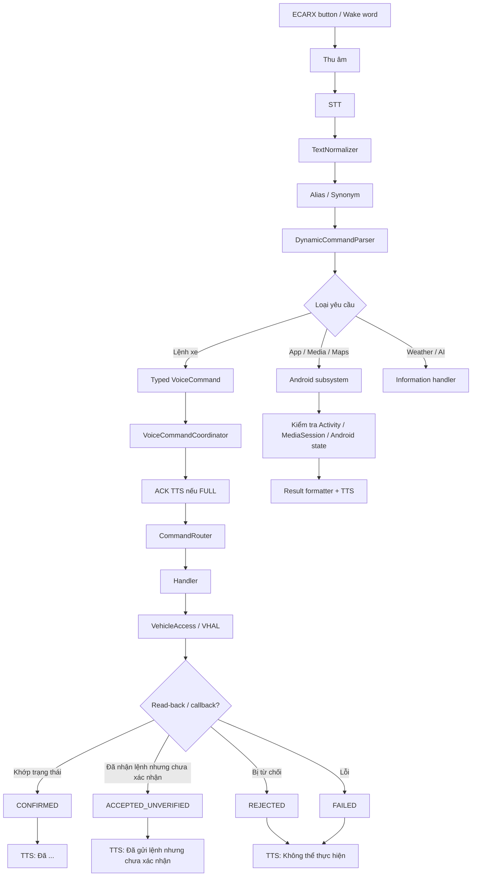

# VoiceGeely — Sơ đồ làm việc

## 1. Luồng tổng thể



## 2. Chu kỳ phản hồi bắt buộc

Mỗi lệnh xe phải đi qua ba pha:

```text
HEARD / PARSED
    ↓
ACKNOWLEDGE
    ↓
EXECUTE
    ↓
VERIFY
    ↓
RESULT
```

### FULL
Ví dụ người dùng nói: `Chỉnh nhiệt độ 22 độ`

1. Parser tạo `SetTemperature(22)`.
2. TTS đọc lại: `Đang chỉnh nhiệt độ về 22 độ.`
3. Handler ghi VHAL.
4. VehicleAccess đọc lại nhiệt độ.
5. Nếu read-back là 22°C: `Đã chỉnh nhiệt độ về 22 độ.`
6. Nếu write được nhận nhưng chưa đọc lại được: `Đã gửi lệnh điều chỉnh nhiệt độ, nhưng chưa xác nhận được trạng thái.`
7. Nếu lỗi: `Thực hiện lệnh không thành công...`

### SHORT
Không đọc ACK. Chỉ nói kết quả cuối. **Mặc định khi bật phản hồi giọng nói** (quyết định chủ repo 30/09/2026: bỏ câu "Đang …", chỉ đọc "Đã …"/lỗi).

### SILENT
Không TTS; command vẫn thực thi và ghi log.

## 3. Quy tắc an toàn phản hồi

- Chỉ `CommandExecutionResult.Confirmed` được phép phát câu có nghĩa "đã thực hiện thành công".
- `AcceptedUnverified` không được biến thành `Confirmed`.
- VHAL write trả về mà chưa read-back không đồng nghĩa xe đã làm xong.
- Với app/media, xác minh bằng Activity state, MediaSession hoặc Android state khi có thể.
- Handler không tự đọc TTS. Mọi phản hồi đi qua `VoiceCommandCoordinator` + `VoiceResponseFormatter`.
- Lệnh mơ hồ phải hỏi lại, không được tự chọn actuator.

## 4. Ví dụ kính

```text
Người dùng: "Hạ kính bên lái xuống 50%"
        ↓
Window(FRONT_LEFT, SET_PERCENT, 50)
        ↓
FULL ACK: "Đang chỉnh kính bên lái xuống 50 phần trăm."
        ↓
WindowHandler -> VehicleAccess -> VHAL
        ↓
Read-back vị trí kính
        ├─ 50% -> CONFIRMED -> "Đã chỉnh kính bên lái xuống 50 phần trăm."
        ├─ không đọc được -> ACCEPTED_UNVERIFIED
        └─ lỗi/denied -> FAILED/REJECTED
```

## 5. Trách nhiệm từng lớp

- `VoiceTextNormalizer`: làm sạch text và lỗi ASR.
- `VoiceCommandParser`: chỉ tạo typed command.
- `VoiceCommandCoordinator`: điều phối ACK -> execute -> result TTS.
- `CommandRouter`: chọn đúng handler.
- `Handler`: gọi backend, không tự phát TTS thành công.
- `VehicleAccess`: write/read VHAL, callback, reconnect/retry có giới hạn.
- `VoiceResponseFormatter`: sinh câu nói nhất quán.
- `VoiceSpeechSink`: adapter tới engine TTS thật.

Cơ chế này là chuẩn mặc định của VoiceGeely từ v1.0 trở đi.
