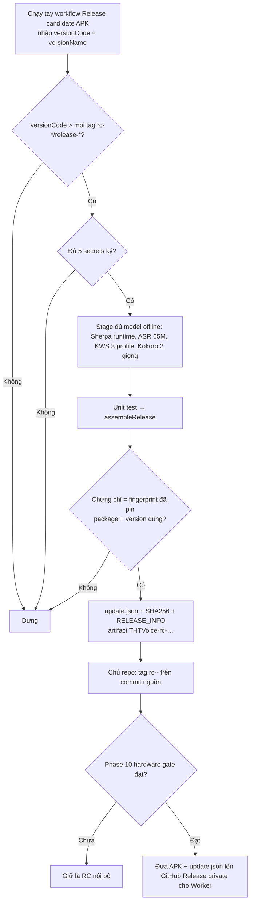

# Phase 11 — Release hardening

Mốc: 29/09/2026. Theo AGENTS.md, test trên IHU689G không chặn phát triển; nhưng **phát hành cho khách hàng** (gắn `stable/release-ready`) vẫn cần gate phần cứng của Phase 10.

## 1. Đã có trong repo

| Thành phần | File | Trạng thái |
|---|---|---|
| Ký release bằng biến môi trường | `app/build.gradle.kts` (`THTVOICE_KEYSTORE_FILE`, `…_STORE_PASSWORD`, `…_KEY_ALIAS`, `…_KEY_PASSWORD`, `THTVOICE_VERSION_CODE/NAME`) | Có sẵn |
| Luồng update an toàn trên xe | `docs/SAFE_UPDATE_RELEASE.md`, `UpdatePackageVerifier`, `ParkedActionGate` | Có sẵn |
| Gate versionCode | `scripts/release/check-version.sh` (+ self-test trong CI) | Mới |
| Kiểm tra APK release | `scripts/release/verify-release-apk.sh`: chứng chỉ ký khớp fingerprint đã pin, package `com.tht.voice`, versionCode/versionName | Mới |
| Metadata cho Worker | `scripts/release/create-update-json.sh`: `update.json`, `SHA256.txt`, `RELEASE_INFO.txt` | Mới |
| Workflow RC | `.github/workflows/release-candidate.yml` (chạy tay) | Mới — chờ secrets |

## 2. Luồng release candidate



## 3. Việc chủ repo cần làm một lần (không thể tự động từ agent)

1. Tạo keystore release **ngoài Git** và sao lưu an toàn (mất keystore = không cập nhật đè được xe đã cài):
   ```bash
   keytool -genkeypair -v -keystore thtvoice-release.jks -alias thtvoice -keyalg RSA -keysize 4096 -validity 10000
   keytool -list -v -keystore thtvoice-release.jks -alias thtvoice   # lấy "SHA256:" fingerprint
   base64 -w0 thtvoice-release.jks > keystore.b64
   ```
2. Thêm GitHub Actions secrets: `THT_SIGN_KEYSTORE_BASE64` (nội dung `keystore.b64`), `THT_SIGN_STORE_PASSWORD`, `THT_SIGN_KEY_ALIAS`, `THT_SIGN_KEY_PASSWORD`, `THT_SIGN_CERT_SHA256` (fingerprint SHA-256, có hoặc không dấu `:`).
3. Chạy workflow **Release candidate APK** với `versionCode=2`, `versionName=1.0.1` (versionCode 1 là bản đầu).
4. Nếu RC tốt: gắn tag `rc-1.0.1-2` lên commit đã build để làm rollback anchor.

## 4. Checklist Phase 11

- [x] Pipeline ký release fail-closed + kiểm tra chứng chỉ/package/version + update.json.
- [ ] Chủ repo tạo keystore + secrets và chạy RC đầu tiên.
- [ ] Thử luồng update trên thiết bị Android test: SHA sai, package sai, version không tăng, chữ ký khác đều bị từ chối; tải gián đoạn; xe không đỗ → deferred.
- [ ] VIN-required binding: chỉ bật sau khi `INFO_VIN` đọc ổn định trên xe.
- [ ] Ảnh chụp hardware validation (sau khi có xe).
- [ ] Gắn `stable/release-ready` chỉ khi Phase 10 hardware gate đạt.

## 5. Phát hành một bấm (quyết định chủ repo 30/09/2026)

Workflow **Release candidate APK** giờ tự phát hành. Để trống `versionCode` và `versionName` thì workflow lấy số lớn nhất trong các tag rồi cộng 1. Khi `publish` bật (mặc định), workflow tạo GitHub Release `release-<versionName>-<versionCode>` và đánh dấu Latest. Release gồm APK, `update.json`, `SHA256.txt`, gói giọng đọc và `voice-pack.json`. Máy chủ bản quyền đọc Release đó cho OTA (`/api/update`) và để app tải giọng (`/api/model`), nên xe thấy bản mới ngay lần **Kiểm tra cập nhật** kế tiếp. Chỉ muốn build để thử mà chưa phát hành thì tắt `publish`.

